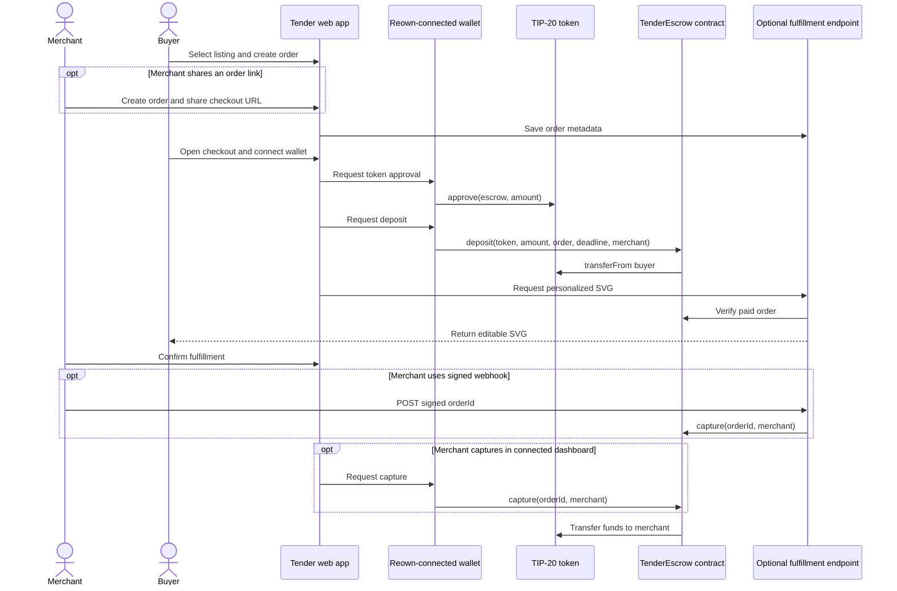

# Tender

**Protected checkout for digital work on Tempo Moderato.**

Tender connects creative digital services with payment: a buyer orders a personalized brand card or launch graphic, pays pathUSD into Tempo Moderato escrow, and downloads an editable SVG. Tender also supports direct pathUSD transfers and reads wallet balances on Tempo. Listings and orders live in Railway PostgreSQL.

[](#license)
[](contracts/TenderEscrow.sol)
[](#development)

[Live app](https://ontender.xyz) · [Repository](https://github.com/Datwebguy/tender) · [Escrow deployment notes](contracts/DEPLOY.md) · [API setup](api/README.md)

## At a glance

| Item | Current value |
| --- | --- |
| Network | Tempo Moderato testnet (`42431`) |
| Payment token | pathUSD, 6 decimals |
| Live catalog | Brand card (`0.10` pathUSD) and Launch graphic (`0.20` pathUSD) |
| Data layer | Railway PostgreSQL for catalog and shared checkout records |
| Frontend | React + Vite, deployed on Vercel |
| Wallet connection | Reown AppKit with Wagmi |
| Contract | `TenderEscrow.sol` on Tempo Moderato; see [deployment notes](contracts/DEPLOY.md) |
| Current status | Testnet prototype; use testnet funds only |

## Contents

- [At a glance](#at-a-glance)
- [Overview](#overview)
- [Judge walkthrough](#judge-walkthrough)
- [The problem](#the-problem)
- [How it works](#how-it-works)
- [Results](#results)
- [Quick start](#quick-start)
- [Usage](#usage)
- [Configuration](#configuration)
- [Design decisions](#design-decisions)
- [Project layout](#project-layout)
- [Development](#development)
- [Deployment](#deployment)
- [Product scope and roadmap](#product-scope-and-roadmap)
- [Security](#security)
- [License](#license)

## Overview

Tender is for a merchant selling a small digital service and a buyer who wants a payment record before work is released. You give it a catalog item, a price, a merchant address, and a deadline. It returns a shareable checkout URL and an escrow-backed order record.

1. A merchant or buyer selects a live catalog item and creates an order.
2. Tender stores the order metadata in Railway PostgreSQL and returns a checkout link.
3. The buyer connects a wallet on Tempo Moderato, approves pathUSD, and deposits into `TenderEscrow`.
4. The server reads the on-chain escrow record before returning the personalized SVG.
5. The order page records delivery and exposes the contract's capture and refund actions.

The test catalog contains two editable SVG design services priced in testnet pathUSD. Each gives a reviewer a ready-to-use order for trying checkout and personalized download.

Highlights:

- Wallet connection uses Reown AppKit with a Wagmi adapter, configured for Tempo Moderato (`src/reown.js`).
- The payment path checks for deployed contract bytecode, requests token approval, then calls `deposit` (`src/tempo.js`).
- The escrow contract records the buyer, merchant, token, amount, and deadline (`contracts/TenderEscrow.sol`).
- Paid orders generate server-verified, editable SVG files (`api/design.js`, `src/DesignStudio.jsx`).
- The dashboard reads live escrow state for orders with transaction hashes (`src/App.jsx`).
- The wallet page reads pathUSD balances, exposes the Moderato faucet, and supports direct transfers (`src/Experience.jsx`, `src/tempo.js`).
- The app is installable as a PWA; its service worker caches only the app shell and leaves API requests online-only (`public/manifest.webmanifest`, `public/sw.js`).
- An optional HMAC-signed fulfillment endpoint can submit capture using a server-side signer (`api/fulfillment.js`).

## Judge walkthrough

The shortest way to inspect the working path is:

1. Open the [live app](https://ontender.xyz) on Tempo Moderato.
2. Select **Brand card** or **Launch graphic** from the catalog.
3. Create the order and open its checkout link.
4. Connect a wallet configured for chain `42431` and fund it with Moderato testnet pathUSD.
5. Approve and deposit the listed amount into the Tender escrow contract.
6. Use the order page to personalize and download the SVG after the server verifies the escrow record.
7. Review the delivery state, then use the permitted capture or refund action.

The catalog entries are deliberately small testnet services so a reviewer can follow the complete path without waiting for a human designer or a physical shipment. They are template-based SVG outputs, not commissioned design work.

## The problem

In a typical online checkout, payment settles before a merchant ships an order. Resolving a delayed, canceled, or disputed order can require a separate support and refund process. Tender demonstrates a checkout where a stablecoin payment remains in a contract until an authorized party captures it or refund conditions are met.

Tender connects a payment to an order record and gives buyer and merchant a shared checkout and settlement workflow. The contract applies the configured capture and refund permissions to each on-chain order.

## How it works



| Concept | Implemented rule |
| --- | --- |
| Network | Tempo Moderato, chain ID `42431`, configured in `src/reown.js` and `src/tempo.js`. |
| Default payment token | pathUSD at the default address in `src/tempo.js`; the UI uses 6 decimal places for payment amounts. |
| Deposit | The buyer first approves the escrow to spend the amount, then deposits against a `bytes32` order ID and deadline. |
| Capture | Only the order's buyer or merchant can capture; the supplied merchant must match the recorded merchant. Capture transfers the full amount to that merchant. |
| Refund | The buyer can refund before the deadline. After the deadline, any caller can trigger refund to the buyer. |
| Fulfillment | Tender records fulfillment status in the order workflow. Contract capture and refund permissions follow buyer, merchant, and deadline rules. |
| Catalog source | Two template-based SVG design listings are stored in `tender_products` and read through `/api/products`. They give reviewers a concrete testnet checkout and design-download flow. |
| Order storage | Railway PostgreSQL stores order records, and checkout links open the same order across browsers. The merchant workspace keeps its order index and management token in browser storage. |
| Design delivery | `/api/design` checks the Tempo escrow record against the product amount, token, merchant, and deadline before returning personalized SVG markup. |
| Wallet tools | The Wallet page reads the connected account balance, exposes the Moderato test faucet, and sends pathUSD through the connected wallet. |

The contract uses explicit `capture` and `refund` calls rather than holding a private key for buyer funds. Wallet transactions are signed by the connected user's wallet. The optional API is separate: it uses a server-held signer to call capture after validating a request signature.

## Results

The evidence below records Tempo RPC reads and transaction receipts, production API and catalog responses, service status, and deployment checks. Each result links to its saved run.

| Observation | Result | Measurement source |
| --- | --- | --- |
| Tempo Moderato RPC read | Chain ID `42431`; configured escrow returned deployed bytecode; the default token reported `PathUSD` and 6 decimals. | JSON-RPC responses saved in `evidence/tempo-readonly-20261012T212507Z.json`. |
| Tempo transaction receipts | Deployment, token approval, deposit, and capture receipts each returned status `0x1`. | `eth_getTransactionReceipt` responses saved in `evidence/tempo-tx-receipts-20261012T212911Z.json`. |
| Current UI build | The redesigned frontend build exited with code 0; Vite emitted dependency directive and large-chunk warnings. | `evidence/ui-redesign-build.log`. |
| Prior source build | `npm run build` exited with code 0; Vite emitted module-level `use client` dependency warnings. | `evidence/build-20261012T220654Z.json` and the full log alongside it. |
| API and service worker syntax | `node --check` exited with code 0 for the API handlers and `public/sw.js`. | `evidence/build-20261012T220654Z.json`. |
| Railway database setup | Schema initialization created `tender_orders` and `tender_products`; see the later `evidence/design-catalog-live.json` for live product rows. | `evidence/railway-postgres-init-20261012T220114Z.json`. |
| Railway service | PostgreSQL status was `SUCCESS`; its TCP proxy status was `ACTIVE`. | `evidence/railway-service-20261012T221036Z.json`. |
| Vercel production deployment | The production deployment status was `READY`. | `evidence/vercel-deployment-20261012T221022Z.json`. |
| Production API | This earlier production run returned an empty catalog before listings were added; a nonexistent order returned HTTP 404 and an unsigned webhook returned HTTP 401. The live catalog was queried again on 12 October 2026. | `evidence/tender-production-api-20261012T221139Z.json`. |
| Production install resources | The root, manifest, service worker, offline page, and 192px/512px icons returned HTTP 200. | `evidence/tender-production-20261012T220838Z.json`. |
| Live service catalog | Railway returned two design listings with testnet pathUSD prices of `0.10` and `0.20`. | `evidence/design-catalog-live.json`. |
| Production UI | Edge loaded the production homepage with HTTP 200, two service cards, no page errors; mobile viewport width was 390px with no horizontal overflow. | `evidence/tender-ui-live-20261012.json` and desktop/mobile screenshots. |
| Current production deployment | Vercel deployment `dpl_2wJHEnhhYUPZH6Atn4tC2rZTyiGH` reported READY. | Vercel CLI inspect, 12 October 2026. |

No connected-wallet purchase, SVG download from a paid order, direct token transfer, faucet request, or browser PWA installation has been completed in this session. No performance results or test-count claims are available.

## Quick start

Requirements: Node.js and npm installed. The repository does not pin their versions. Shared order storage also requires a Railway PostgreSQL database.

Tender is an installable web app on supported mobile and desktop browsers. Its service worker caches the app shell; catalog, order, and wallet actions use the network.

1. Clone the repository and install its dependencies:

   ```sh
   git clone https://github.com/Datwebguy/tender.git
   cd tender
   npm install
   ```

2. Create a Railway PostgreSQL database and run `api/schema.sql` in its SQL editor. Add the merchant's real, active products to `tender_products`; the schema does not seed products. Copy `.env.example` to `.env.local`. Set the Reown project ID and database URL. The store name is optional; it defaults to Tender workspace. For live checkout, also set the deployed escrow and merchant addresses. Do not put a private key in this file.

   ```env
   VITE_REOWN_PROJECT_ID=...
   VITE_TENDER_ESCROW_ADDRESS=...
   VITE_TENDER_MERCHANT_ADDRESS=...
   VITE_TENDER_STORE_NAME=...
   VITE_TEMPO_TOKEN_ADDRESS=0x20c0000000000000000000000000000000000000
   VITE_TEMPO_TOKEN_SYMBOL=pathUSD
   DATABASE_URL=...
   TENDER_ESCROW_ADDRESS=...
   TENDER_TEMPO_TOKEN_ADDRESS=...
   ```

   `VITE_REOWN_PROJECT_ID` is required for app initialization. `DATABASE_URL` enables shared order creation and checkout links. Without escrow and merchant addresses, the UI can load, but it cannot submit a live escrow payment. The address shown above is Tempo Moderato pathUSD; change the token address and symbol together if using a different supported TIP-20 token.

3. Start the Vercel development server so both the Vite frontend and `/api` functions are available:

   ```sh
   npm run dev:vercel
   ```

Vite prints the local URL when it starts. Open that URL in a browser. Wallet connection and live transactions require a wallet configured for Tempo Moderato and the deployed escrow contract.

## Usage

Tender has no application-specific command-line parser. The available commands are the npm scripts declared in `package.json`.

| Command | Flags | Purpose |
| --- | --- | --- |
| `npm run dev` | None | Start Vite with host binding `0.0.0.0`. API routes are not served by this command. |
| `npm run dev:vercel` | None | Start Vercel's local development server for the frontend and serverless API routes. |
| `npm run build` | None | Build the static frontend into `dist/`. |
| `npm run preview` | None | Preview the built frontend locally with Vite. Run `npm run build` first. |

There are no app-specific CLI flags. `npm install` installs the dependencies listed in `package.json` and `package-lock.json`. `dev:vercel` runs the Vercel CLI through `npx`; the first run may require Vercel CLI authentication and project linking.

## Configuration

All frontend environment variables are read by the Vite client and become public in the generated frontend bundle. Do not put secrets in `VITE_` variables.

| Key | Required | Meaning |
| --- | --- | --- |
| `VITE_REOWN_PROJECT_ID` | Yes | Reown AppKit project identifier. `src/reown.js` throws during app initialization if it is empty. |
| `VITE_TENDER_ESCROW_ADDRESS` | For live escrow | Tender escrow contract address on Tempo Moderato. |
| `VITE_TENDER_MERCHANT_ADDRESS` | For live checkout and dashboard settlement | Merchant wallet that receives captured funds. |
| `VITE_TENDER_STORE_NAME` | No | Optional store label. The app displays “Tender workspace” when unset. |
| `VITE_TEMPO_TOKEN_ADDRESS` | No | TIP-20 token used for checkout. If unset, `src/tempo.js` uses the pathUSD address. |
| `VITE_TEMPO_TOKEN_SYMBOL` | No | Symbol displayed by the UI. The app defaults to `pathUSD` only with the default pathUSD address; custom token address and symbol must be configured together. The token must use 6 decimals. |
| `DATABASE_URL` | Yes for shared orders | Server-only Railway PostgreSQL connection string used by `api/orders.js`. Run `api/schema.sql` before using the API. |
| `TENDER_ESCROW_ADDRESS` | For on-chain order updates and webhook | Server-side escrow address used to verify live order state and by the webhook. If unset, order updates fall back to `VITE_TENDER_ESCROW_ADDRESS` when available. |
| `TENDER_TEMPO_TOKEN_ADDRESS` | Optional for server API | Server-side token address expected when verifying a payment. Defaults to pathUSD if unset. |
| `TENDER_WEBHOOK_SECRET` | For webhook | Server-only HMAC secret used to validate `x-tender-signature`. |
| `TENDER_MERCHANT_PRIVATE_KEY` | For webhook | Server-only private key used by the API signer. It must belong to the buyer or merchant permitted to capture the order. |
| `TENDER_MERCHANT_ADDRESS` | For webhook | Merchant passed to the contract's `capture` call. If unset, the API uses the address derived from `TENDER_MERCHANT_PRIVATE_KEY`. |

`DATABASE_URL`, `TENDER_ESCROW_ADDRESS`, and optional `TENDER_TEMPO_TOKEN_ADDRESS` are server-only settings for order and payment verification. `TENDER_WEBHOOK_SECRET` and `TENDER_MERCHANT_PRIVATE_KEY` are only used by `api/fulfillment.js`. Configure them as server environment variables in Vercel. `.env.example` shows the names; `api/README.md` documents database setup and webhook use.

## Design decisions

- **Payments on Tempo Moderato:** payment actions require chain ID `42431`. The wallet adapter also offers Ethereum for initial connection when a wallet has not added Moderato yet. Wallet help provides an explicit add/switch action and manual network settings.
- **Wallet-owned signing:** buyers approve and deposit through their connected wallet. The frontend does not accept or store private keys.
- **TIP-20 amount precision:** checkout parses amounts with 6 decimals, matching the configured pathUSD token.
- **Contract-enforced authorization:** for on-chain orders, the contract checks the buyer or merchant for capture and the buyer or deadline for refund. The app does not create or advance local-only orders.
- **Shared checkout records:** Railway PostgreSQL stores order details so buyers can open checkout links in another browser. The dashboard copy and management token remain in the browser; there is no merchant account or cross-device dashboard yet.
- **Optional server capture:** a signed webhook can submit capture without a merchant opening the dashboard, but requires a server-side signer and valid HMAC configuration.

## Project layout

```text
tender/
├── api/
│   ├── README.md             # Order API and fulfillment webhook setup
│   ├── design.js             # Payment-verified personalized SVG design endpoint
│   ├── fulfillment.js        # HMAC-validated server endpoint that calls capture
│   ├── orders.js             # Railway PostgreSQL-backed order create, checkout read, and status API
│   ├── products.js           # Active catalog endpoint backed by Railway PostgreSQL
│   └── schema.sql            # Product catalog and order table schema
├── artifacts/
│   └── TenderEscrow.json     # Contract artifact included in the repository
├── contracts/
│   ├── DEPLOY.md             # Contract deployment notes
│   └── TenderEscrow.sol      # Escrow contract source
├── evidence/                 # Timestamped RPC, HTTP, database, and build evidence
├── public/
│   ├── brand-card.svg         # Brand card template preview
│   ├── launch-graphic.svg     # Launch graphic template preview
│   ├── icon-*.png, icon.svg   # App icons
│   ├── manifest.webmanifest  # Installable web app metadata
│   ├── offline.html          # Honest offline state
│   └── sw.js                 # App shell cache; API requests bypass it
├── src/
│   ├── App.jsx               # Dashboard, checkout, and order state UI
│   ├── Brand.jsx             # Tender symbol and wordmark
│   ├── DesignStudio.jsx      # Paid design customization and download UI
│   ├── Experience.jsx        # Homepage, live service cards, and wallet tools
│   ├── main.jsx              # React entry point and providers
│   ├── reown.js              # Reown AppKit and Tempo Moderato configuration
│   ├── style.css             # App and responsive styles
│   └── tempo.js              # Tempo contract interactions and reads
├── .env.example              # Frontend environment variable template
├── .vercelignore             # Excludes environment files and evidence from deployment
├── index.html                # Vite HTML entry point
├── package.json              # Dependencies and npm scripts
├── package-lock.json         # Locked npm dependency tree
├── vercel.json               # Vercel build and function configuration
└── vite.config.js             # Vite configuration
```

## Development

The scripts below are the exact development checks declared in `package.json`:

| Check | Command | Availability |
| --- | --- | --- |
| Lint | Not configured | No lint script or linter configuration is present. |
| Type-check | Not configured | The project is JavaScript/JSX and has no type-check script or TypeScript configuration. |
| Tests | Not configured | No test script or test files are present. |
| Production build | `npm run build` | Configured; builds with Vite. |

Run the configured build with:

```sh
npm run build
```

## Deployment

`vercel.json` configures Vercel to run `npm run build`, serve the `dist/` output, and deploy the API functions in `api/`.

Production is connected to Railway PostgreSQL through a server-only Vercel `DATABASE_URL`; the schema is initialized. The public TCP proxy enables Vercel to connect and can incur Railway network egress charges. The live catalog contains two design services. Add merchant authentication and real service providers before using Tender to coordinate commissioned work.

1. Import the repository into a Vercel project.
2. Add the `VITE_` variables from [Configuration](#configuration) to the Vercel project's frontend environment.
3. If using the webhook, add all required `TENDER_` variables as server-only environment variables. Keep `TENDER_MERCHANT_PRIVATE_KEY` out of all `VITE_` variables.
4. Deploy the project. Vercel builds the frontend and exposes `/api/products`, `/api/orders`, `/api/design`, and `/api/fulfillment`.

To roll back, use the Vercel project dashboard to promote a previous successful deployment.

The live app and contract addresses above describe the public testnet configuration. Server secrets and operator runbooks are kept outside this public repository.

## Product scope and roadmap

- **Testnet commerce:** Tender currently runs on Tempo Moderato with testnet pathUSD. The catalog contains two template-based SVG design products so reviewers can try an order and personalize a download.
- **Order workspace:** Railway PostgreSQL stores shared order and checkout records. The merchant workspace keeps its order index and management token in browser storage; merchant accounts and a shared cross-device dashboard are planned next.
- **Fulfillment and settlement:** Tender records delivery status in the order workflow. Tempo escrow applies buyer, merchant, and deadline rules to capture and refund. Connecting verified fulfillment events to settlement is a roadmap item.
- **Wallet and app access:** Reown AppKit connects EVM wallets; the responsive web app can be installed from supported browsers. The wallet page supports balance checks, test-token requests, and direct transfers.
- **Optional webhook:** The signed fulfillment endpoint can submit a capture with a configured signer. Its upstream event and order-state checks should be completed before using it for automated fulfillment.

## Security

- Never store a private key in Git, `.env.local` under a committed path, or any `VITE_` variable. Vite embeds `VITE_` values in client assets, where users can read them.
- Reown Project ID and contract/token addresses are public client configuration. They are not signing credentials.
- The optional webhook private key must be set only in the server environment. Its account must be authorized by the contract as the buyer or merchant for orders it captures.
- Webhook requests must include `x-tender-signature` with `sha256=` followed by the HMAC-SHA256 digest of the request body, using `TENDER_WEBHOOK_SECRET`. The endpoint rejects invalid signatures and non-POST requests.
- The contract is a minimal escrow implementation. Review `contracts/TenderEscrow.sol` and obtain an independent security review before handling valuable funds; this repository contains no audit report.
- To report a vulnerability, use GitHub's private vulnerability reporting for this repository if it is enabled. Otherwise, open a private contact channel with the repository maintainers before publishing exploit details. No security contact address is specified in the repository.

## License

**Not specified.** The Solidity source declares `SPDX-License-Identifier: MIT`, but the repository has no root `LICENSE` file and `package.json` marks the package as private. The maintainer must choose and add a repository license before others can rely on an open-source license grant.
